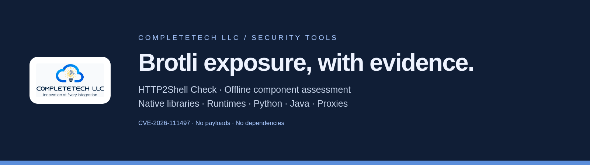
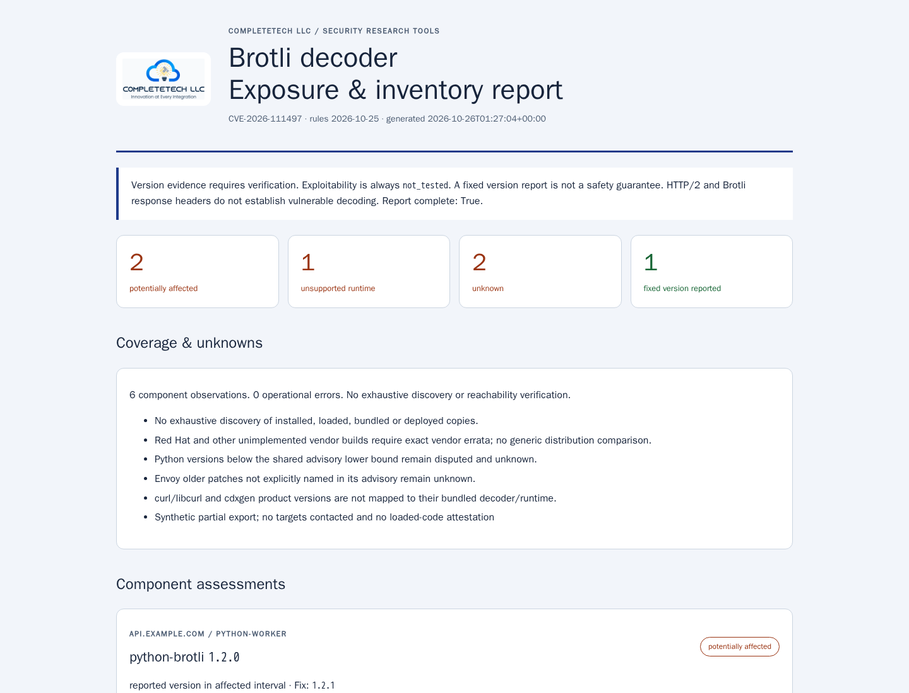

<p align="center"></p>

<p align="center">
<a href="https://github.com/CompleTetech-Security/http2shell-check/actions/workflows/tests.yml"></a>


<a href="LICENSING.md">AGPL-3.0 / commercial</a>
</p>

# Brotli decoder exposure, with evidence

`http2shell-check` assesses reported versions and inventories for **CVE-2026-111497**, the Google Brotli decoder vulnerability also called **HTTP2Shell** or **Node2Shell**. These names describe the same underlying flaw. HTTP/2 is not required.

Assess native Brotli, Node.js, Bun, Python Brotli/brotlicffi, Brotli4j, Envoy, Istio, and exact Debian source-package snapshots. The standalone Python checker makes no network requests, imports no decoder, and sends no exploit payloads. Version comparisons are triage; exploitability is always `not_tested`.

## Quick start

```sh
git clone https://github.com/CompleTetech-Security/http2shell-check.git
cd http2shell-check
python http2shell_check.py --component brotli=1.2.0 --format json
python http2shell_check.py --component python-brotli=1.2.1 --component bun=1.4.3
python http2shell_check.py --inventory examples/inventory.json --format html --output report.html
python collect_python.py > runtime.json
python http2shell_check.py --inventory runtime.json --format json
```

Python 3.10+ on Windows, Linux, or macOS; nothing to install. Use `python3` if needed. The checker file works when copied elsewhere; supply `--logo approved-logo.png` if desired. Existing output files are refused unless `--force` is given. Keep real inventories and reports outside Git.

## The report

One offline, script-free HTML file includes an embedded logo, summary counts, prioritized component observations, evidence, unknowns, coverage gaps, remediation, branch fixes, and source links. It adapts to light/dark themes and prints cleanly. Use `--brand "Your Organization" --logo approved-logo.png` for custom branding.

<picture><source media="(prefers-color-scheme: dark)" srcset="docs/images/report-dark.png"></picture>

[Open the synthetic example](docs/example-report.html). Screenshots show actual generated output; no targets were scanned. [Narrow layout](docs/images/report-narrow.png) · [Print preview](docs/images/report-print.png).

## Interpreting results

| Status | Meaning |
| --- | --- |
| `potentially_affected` | Reported version matches a verified affected interval or exact vendor package. Validate the actual deployed copy and input paths. |
| `fixed_version_reported` | Version meets the applicable rule; deployed patch state and safety remain unverified. |
| `unsupported_runtime` | Older unsupported Node.js line requires upgrade/vendor review; this is not CVE confirmation. |
| `unknown` | Missing, disputed, qualified, custom, conflicting, or uncovered evidence needs review. |

`--fail-on-finding` returns 1 for affected/unsupported results; operational failures return 2; interruptions return 130. Unknown results do not trigger 1 and are prominently counted. A successful command is not a clean security assessment.

## Coverage and limitations

Rules are embedded and dated **2026-10-25**. Native Brotli maintenance fixes are independent from runtime and package fixes. Python ranges disputed below the shared advisory lower bound remain unknown. Envoy findings use exact affected patches named by its maintainer. Debian assessment requires exact source package/release/version provenance; it does not infer patch state for binary packages or Node.js from libbrotli alone. Red Hat generic comparisons are disabled.

No exhaustive discovery, SBOM ingestion, loaded-code attestation, passive website scanning, or reachability tests are provided. This tool complements [node2shell-check](https://github.com/CompleTetech-Security/node2shell-check), whose Node.js interface and ownership remain unchanged. [Scope and template parity](docs/SCOPE.md) · [Verified source matrix](docs/SOURCES.md).

## Inputs and documentation

- [CLI and schemas](docs/REFERENCE.md): canonical multi-component JSON, pip-list subset, existing Node collector adapter, all options and exit codes.
- [Brotli methodology](docs/HTTP2SHELL.md): affected/fixed intervals, uncertainty, decoder prerequisites, mitigation and remediation.
- [Agent skill](skills/http2shell-check/SKILL.md): invokes this CLI using authorized local inventories, including after separate installation.
- [Contributing](CONTRIBUTING.md) · [Security policy](SECURITY.md) · [Changelog](CHANGELOG.md).

To install the agent skill separately, copy the entire `skills/http2shell-check/` directory to `.agents/skills/http2shell-check/` in your chosen project, or your agent's personal skill directory. Preserve any existing installation before copying. The installed skill locates the checker separately; it does not bundle another implementation.

```sh
python -m unittest -v
python http2shell_check.py --help
git diff --check
```

## License and branding

[AGPL-3.0](LICENSE), including commercial use under its terms, or a separately agreed [commercial license](LICENSING.md) from CompleteTech LLC. Names and logos have [separate brand restrictions](BRAND_ASSETS.md).

<p align="center"><a href="https://complete.tech"></a><br>Built by CompleteTech LLC · Innovation at Every Integration</p>
